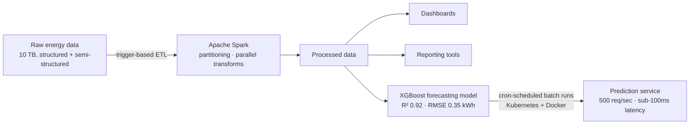

# Energy Consumption Prediction — Spark ETL & Forecasting Pipeline

A distributed data pipeline and forecasting system for hourly energy consumption (kWh), built on **Apache Spark**, orchestrated on **Kubernetes + Docker**, with an **XGBoost** forecasting model served as a containerized prediction service.

## What it does

1. **Trigger-based ETL (Apache Spark)** — processes **10 TB** of structured and semi-structured data in **under 4 hours**, using partitioning, parallel processing, and optimized transformations to improve throughput and scalability over a single-node approach.
2. **Downstream consumers** — the processed data feeds **dashboards, ML models, and reporting tools**.
3. **Forecasting model (XGBoost)** — time-series prediction of hourly energy consumption, achieving **R² 0.92** and **RMSE 0.35 kWh** on held-out test data, through feature engineering, hyperparameter tuning, and evaluation against baseline models.
4. **Batch prediction, orchestrated** — the batch prediction pipeline runs on a **cron scheduler on Kubernetes and Docker**.
5. **Prediction service** — deployed as a containerized Docker service sustaining **500 req/sec** throughput at **sub-100ms** prediction latency.

## Architecture

## Tech stack

Python · Apache Spark · XGBoost · Docker · Kubernetes · AWS

## Results at a glance

| Metric | Value |
|---|---|
| ETL volume | 10 TB |
| ETL runtime | under 4 hours |
| Forecast accuracy | R² 0.92, RMSE 0.35 kWh (held-out test data) |
| Prediction service | 500 req/sec at sub-100ms latency |

## About

Built by Sriharshita Avadhanam — Software Engineer (3 yrs, Sentier Technologies), MS Computer Science, NJIT.
Questions or feedback welcome via [LinkedIn](https://linkedin.com/in/sriharshita-avadhanam).
